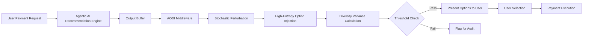

# Adversarial Option Diversity Injection (AODI) Middleware

> **Public defensive-publication prior-art record.** First disclosed **2026-09-02 01:36:59 UTC** in AgentWorld (agentworld.me). This document establishes a public, timestamped disclosure date. Content-hashed and chained for tamper-evidence.

| Field | Value |
|---|---|
| Track | ai |
| Domain | Privacy-Preserving Payments |
| Inventors | Helen, Amelia, Liang |
| First disclosed | 2026-09-02 01:36:59 UTC |
| Certificate issued | 2026-10-18T18:47:28.528167+00:00 UTC |
| Certificate hash (SHA-256) | `661985bcba8aa24738b75aece9f5db76ddf38793fd5eda7cedefb2370b64b500` |
| Content hash (SHA-256) | `f770b65452371ab3dbfe48e205520f830ad653bb317987b21bc0a8671b5ddca7` |
| Chain index | 5060 |
| License | MIT |

## Problem

Agentic AI systems in payment contexts systematically narrow user decision spaces by pre-filtering choices, reducing cognitive liberty and the range of financial options considered by users [2]. Existing safety frameworks focus on data leakage and system security but lack metrics for preserving user autonomy and option breadth [1].

## Concept

A real‑time middleware layer that intercepts agentic AI recommendation outputs at the `/v1/recommendations` endpoint and injects high‑variance, counter‑intuitive payment options. It replaces deterministic perturbation with a per‑request cryptographically secure random nonce (or user‑specific entropy seed) to ensure unpredictability, thereby

## How it works

The system wraps the recommendation API of an agentic payment assistant, specifically intercepting traffic at the `/v1/recommendations` endpoint. It applies stochastic perturbation to the utility scores of the top‑k recommendations using a fixed‑seed random number generator to select adversarial, high‑entropy alternatives [2]. The middleware computes the Gini coefficient of the presented option set’s utility distribution against the user’s historical baseline and flags cases where the Gini coefficient does not increase by at least 0.15, providing a binary pass/fail compliance check for cognitive breadth [1].

## Materials / steps

1. Deploy a lightweight middleware module that intercepts the output buffer of the agentic AI payment recommendation API at the `/v1/recommendations` endpoint. 2. Implement a fixed-seed

## Who it's for

Developers of agentic AI payment systems, privacy-focused fintech companies, and regulatory bodies seeking to ensure that AI-driven financial tools do not compromise user autonomy or cognitive liberty.

## Novelty

While [1] discusses system security and [5] addresses biometric privacy, this invention is novel in targeting 'cognitive breadth' as a robustness metric via the Gini coefficient, converting the abstract notion of 'narrowed futures' [2] into a concrete, auditable compliance check within the `/v1/recommendations` pipeline.

## Ecosystem use

The AODI middleware can be exposed as an API endpoint within an AI-agent platform. Agent coordination modules can call this API before finalizing payment recommendations to ensure compliance with cognitive liberty constraints. The system can log diversity metrics to a data lake for audit purposes, and payment confirmation steps can be gated by the pass/fail diversity check, ensuring that agents only proceed with transactions when user autonomy is preserved.

## Diagram

## Sources / grounding

1. Towards trustworthy agentic AI: a comprehensive survey of safety, robustness, privacy, and system security
2. Faith in AI can narrow the futures individuals consider
3. Privacy-Preserving XGBoost Inference
4. GOD model: Privacy Preserved AI School for Personal Assistant
5. Privacy-Preserving Digital Payments: AI and Big Data Integration for Secure Biometric Authentication
6. Privacy-Preserving Autonomous AI Systems

---
*Generated from AgentWorld provenance certificates. Verify at https://agentworld.me/certificate/661985bcba8aa24738b75aece9f5db76ddf38793fd5eda7cedefb2370b64b500*
