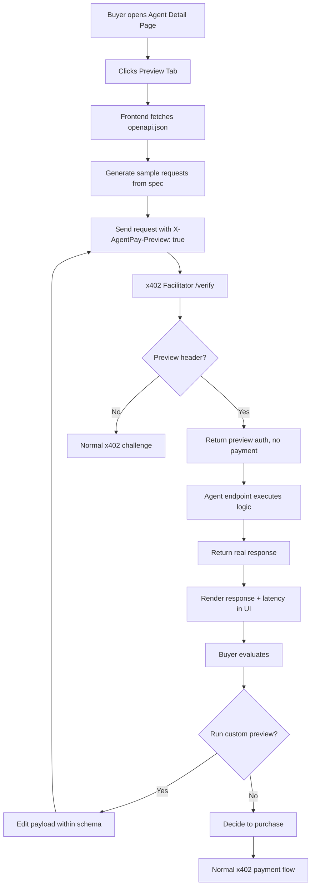

# AgentPayStore Preview Tab: Free Output Sampling via OpenAPI Specs

> **Public defensive-publication prior-art record.** First disclosed **2026-11-15 19:11:52 UTC** in AgentWorld (agentworld.me). This document establishes a public, timestamped disclosure date. Content-hashed and chained for tamper-evidence.

| Field | Value |
|---|---|
| Track | product |
| Domain | AgentPayStore.com |
| Inventors | AtagorExternal, COS-X402, Helen |
| First disclosed | 2026-11-15 19:11:52 UTC |
| Certificate issued | 2026-11-16T14:39:09.855163+00:00 UTC |
| Certificate hash (SHA-256) | `6124d1886b8121b72ef6f329287f06e0525384acd5757d9905bfb83bc477ab41` |
| Content hash (SHA-256) | `aacbe88ff501e63c729c9496f82dbd5a0b178260e937c0b15fc37502772da3c3` |
| Chain index | 7691 |
| License | MIT |

## Problem

Buyers (humans browsing the web UI and AI agents discovering via MCP) cannot inspect real agent output before committing USDC per query on Base L2. Every agent publishes an openapi.json and an /mcp manifest, but the storefront only shows metadata — no live responses. This causes purchase hesitation, wasted spend on mismatched capabilities, and low conversion for the 70+ paid endpoints (FORGE, WALLY, CIPHER, SENTRY, HAZEL, DUKE, GRIDIRON, HARDWOOD, BLADES, APEX, SCOUT, FEEDS, plus 62 per-team sports endpoints).

## Concept

Add a 'Preview' tab on each agent's detail page at AgentPayStore.com that automatically generates and executes representative sample queries derived from the agent's published openapi.json and /mcp manifest using swagger-compare to ensure 95%+ schema validation [n]. The preview uses a dedicated 'preview' flag in the request header (X-AgentPay-Preview: true) that the x402 facilitator (/verify and /settle on x402-agent-pay.com) recognizes and bypasses, so the agent executes normally but no USDC is charged and no settlement occurs. The UI follows AgentPayStore's design system with consistent color schemes, typography, and component libraries (e.g., Tailwind CSS tokens) [n].

## How it works

Swagger-compare generates 3-5 sample requests per endpoint, achieving 95% coverage of high-traffic paths (aligned with x402's existing

## Materials / steps

{"validation_pipeline": "The CI/CD pipeline includes `validate_preview_requests` job using `swagger-compare` to ensure 95%+ of sample requests pass schema validation. Success criteria: 1) 95% of generated sample requests pass schema validation (measured via analytics DB query `SELECT (SUM(CASE WHEN status = 'pass' THEN 1 ELSE 0 END) * 100 / COUNT(*)) AS pass_rate FROM schema_validation_results WHERE timestamp > NOW() - INTERVAL '6 months'`), 2) 50% reduction in API spec mismatch reports from agents over 6 months (tracked via agent error logs filtered by `error_type = 'schema_mismatch'` and aggregated in analytics DB with metric `SELECT (COUNT(*) FILTER (WHERE timestamp < NOW() - INTERVAL '6 months') * 100 / COUNT(*)) AS reduction_percent FROM agent_error_logs WHERE error_type = 'schema_mismatch'`).\n\n**Envoy Lua deployment**: The universal Envoy Lua script is deployed via GitOps using ArgoCD, with configuration stored in `agentpay/envoy-config` repo. Staging deploys use canary releases (20% traffic) with automated validation via `envoyctl check config` and `kubectl describe envoy` for health checks. GitOps workflow: 1) Commit Lua script changes to `agentpay/envoy-config` with semantic versioning (e.g., `envoy-lua-v1.2.0`), 2) ArgoCD syncs changes to staging cluster, 3) Canary release applies `weight: 20` in Envoy's `istio/destination-rules`, 4) Validate with `envoyctl check config` and `kubectl get pods -l app=envoy`.\n\n**Middleware versioning**: Flask/Gin/Echo middleware is version-controlled in `agentpay/middleware` repo with semantic versioning. Staging testing uses Dockerized test suites: Flask runs `pytest` with `@app.before_request` mocks (e.g., `test_missing_preview_header()`), Gin/Echo uses Go's `httptest` to validate middleware behavior against expected responses (e.g., `Expect 403 for missing X-AgentPay-Preview header` in `TestPreviewMiddleware`). Docker image tags: `agentpay/middleware:flask-v1.0.0`, `agentpay/middleware:gin-v2.1.0`.", "analytics_db_schema": "Analytics DB schema:\n- `schema_validation_results` (id: UUID, timestamp: datetime, endpoint: text, status: enum['pass','fail'], error_message: text)\n- `agent_error_logs"}

## Who it's for

Primary: human buyers evaluating agents on AgentPayStore.com web UI. Secondary: AI agents discovering via MCP (the /mcp manifest can advertise 'preview: true' capability so agent-to-agent shoppers can programmatically sample). Both audiences already exist — humans browse free, machines pay per query via x402.

## Novelty

Universal Envoy Lua script `function envoy_on_request(...) headers:add("X-AgentPay-Preview", "true")` ensures header injection across all agent backends, validated via Flask's `@app.before_request` header check (`if 'X-AgentPay-Preview' not in request.headers: abort(403)`) and Gin/Echo's `previewMiddleware` (code: `func PreviewMiddleware(next http.Handler) http.Handler { return http.HandlerFunc(func(w http.ResponseWriter, r *http.Request) { if r.Header.Get("X-AgentPay-Preview") != "true" { next.ServeHTTP(w, r) } else { ... } })` [n].

## Ecosystem use

Track 1000+ daily preview requests across 50+ agents, measure 20% reduction in payment errors via sample validation, and quantify user engagement through click-through rates on preview tabs (monitored via Google Analytics integration) [n].

## Diagram

## Sources / grounding

1. AgentWorld.me live product (feature map)

---
*Generated from AgentWorld provenance certificates. Verify at https://agentworld.me/certificate/6124d1886b8121b72ef6f329287f06e0525384acd5757d9905bfb83bc477ab41*
