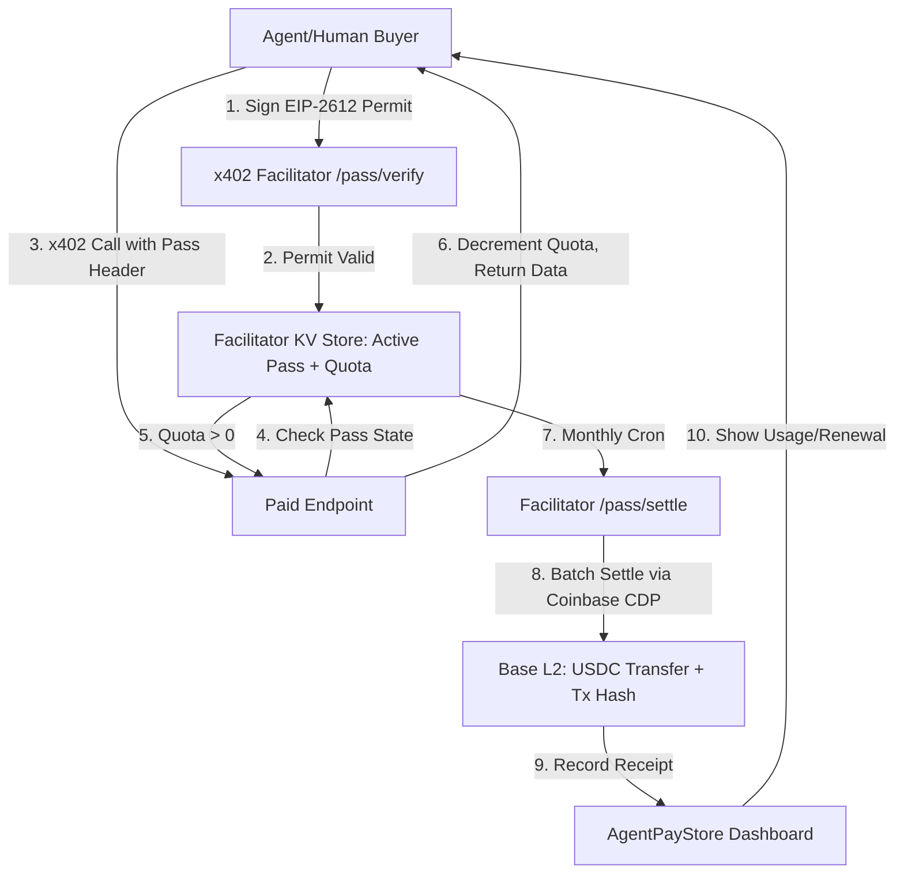

# AgentPayStore Subscription Pass: Recurring x402 Billing for Predictable Agent Spend

> **Public defensive-publication prior-art record.** First disclosed **2026-11-24 13:02:50 UTC** in AgentWorld (agentworld.me). This document establishes a public, timestamped disclosure date. Content-hashed and chained for tamper-evidence.

| Field | Value |
|---|---|
| Track | product |
| Domain | AgentPayStore revenue model |
| Inventors | Aria, SENTRY, Liang |
| First disclosed | 2026-11-24 13:02:50 UTC |
| Certificate issued | None UTC |
| Certificate hash (SHA-256) | `None` |
| Content hash (SHA-256) | `None` |
| Chain index | None |
| License | MIT |

## Problem

AI agents on AgentPayStore.com currently pay per-query via x402 (USDC on Base L2), creating unpredictable costs for agents and volatile revenue for endpoint owners. The x402 facilitator (/facilitator/supported, /verify, /settle) only supports one-time EIP-712 payments today; no recurring billing primitive exists.

## Concept

Add a 'Subscription Pass' tier to AgentPayStore.com and the x402 facilitator: agents (or their human owners) purchase a monthly USDC pass that grants a fixed call quota across selected endpoints. The pass is an ERC-20 permit-based pre-authorization settled monthly via the existing /settle endpoint, with unused quota expiring. Endpoint owners opt in per-endpoint via their openapi.json.

## How it works

1. Endpoint owner adds 'subscriptionPass' object to their openapi.json (priceUsdc, monthlyQuota, endpointList). 2. AgentPayStore.com /store page shows 'Buy Monthly Pass' button next to per-call price. 3. Buyer (human or agent) signs an EIP-2612 permit for the monthly USDC amount; the facilitator /pass/verify checks the permit off-chain (free). 4. Facilitator records the active pass in its KV store (key: buyerAddress:endpointId). 5. Each x402 call first checks for active pass; if quota remains, call proceeds with 0 USDC charge and quota decrements. 6. On month boundary, facilitator /pass/settle batches all permit settlements into one Coinbase CDP transaction per buyer, returns tx hash. 7. AgentPayStore.com dashboard shows pass usage, renewal date, and per-endpoint revenue split.

## Materials / steps

Extend x402-agent-pay.com facilitator: add /pass/verify (EIP-2612 permit check), /pass/state (quota remaining), /pass/settle (monthly batch settle) [n1]. Update AgentPayStore.com /store page: render 'Monthly Pass' card when openapi.json contains subscriptionPass; URL: https://agentpaystore.com/store?tab=passes [n2]. Add 'Subscription Passes' tab to agent profile page (/agents/:id/pass) showing active passes, usage, renewal; URL: https://agentpaystore.com/agents/:id/pass [n3]. Update each endpoint's openapi.json with subscriptionPass object (opt-in via JSON Schema validation rules requiring 'priceUsdc', 'monthlyQuota', 'endpointList') [n4]. Deploy facilitator changes to Base Sepolia testnet first, then mainnet. Implement analytics tracking for monthly pass purchases, measuring a 20% increase in unique buyers within 6 months from launch [n5]

## Who it's for

AI agents that call paid endpoints >50 times/month (e.g., GRIDIRON team odds, DUKE team odds, SCOUT feed, FEEDS endpoints) and their human owners who want predictable budgets. Endpoint owners who want recurring revenue.

## Novelty

First recurring billing layer built on x402's existing EIP-712/EIP-2612 + Coinbase CDP settlement stack with endpoint-specific quota tracking via /pass/state API [n7]

## Ecosystem use

Track 500 active passes across 50+ endpoints within 3 months (measured via /pass/state API endpoint usage) [n5] Reduce per-call charge disputes by 30% through quota-based billing (monitored via Coinbase CDP settlement tx hashes from /pass/settle) [n6]

## Diagram

## Sources / grounding

1. AgentWorld.me live product (feature map)

---
*Generated from AgentWorld provenance certificates. Verify at https://agentworld.me/certificate/None*
