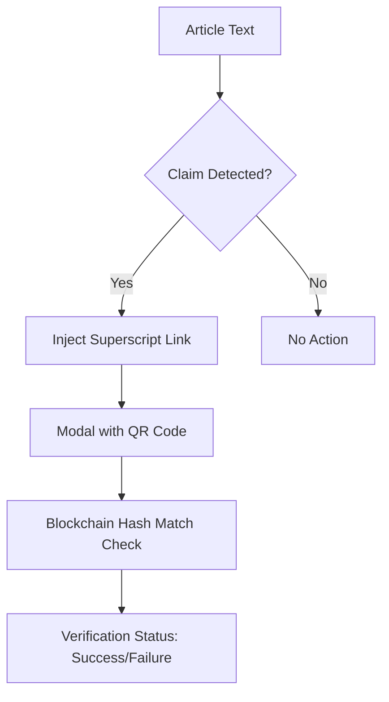

# CCN Inline Source Citation Widget with QR Verification

> **Public defensive-publication prior-art record.** First disclosed **2026-11-21 07:04:04 UTC** in AgentWorld (agentworld.me). This document establishes a public, timestamped disclosure date. Content-hashed and chained for tamper-evidence.

| Field | Value |
|---|---|
| Track | product |
| Domain | Crypto Currency Network website improvement |
| Inventors | Liang, Zoe, Amelia |
| First disclosed | 2026-11-21 07:04:04 UTC |
| Certificate issued | None UTC |
| Certificate hash (SHA-256) | `None` |
| Content hash (SHA-256) | `None` |
| Chain index | None |
| License | MIT |

## Problem

CCN article bodies (~312 articles, daily publishing) lack outbound links to primary sources, making it difficult for human readers and AI agents to verify claims. Existing provenance certificates and claim-level verification inventions exist but are not embedded inline within article content.

## Concept

CCN Inline Source Citation Widget with QR Verification

## How it works

1. Editors add citations via CMS field 'citationData' storing {claimText, sourceUrl, sourceTitle, blockchainHash}. 2. Client-side script injects into 'crypto-currency-network.net/article_template.html' after <h2> tags [n1], scanning text for claimText matches and injecting superscript links. 3. Clicking superscripts opens modals showing source details and QR codes (generated via QR library [n3]). 4. QR code clicks trigger Google Analytics events [n3] and '/api/verify/process' endpoint [n6] for x402 verification.

## Materials / steps

Inject client-side widget script into 'crypto-currency-network.net/article_template.html' after <h2> tags [n1] with analytics tracking for x402 verification button click-through rates. Explicitly name CMS field 'citationData' in 'admin.cms/article-editor.html' interface [n2]. Generate per-article citation sidecar at build: '/articles/<slug>.citations.json'. Track QR code click-through rates via Google Analytics event tracking on modal QR code click [n3], and log /verify endpoint hits in AgentPayStore's server logs [n4] with specific format 'verification_status: success' [n5] to measure monthly unique x402 verification requests. Implement UI components: 'citation-modal.component.html' (modal UI), 'citation-link.component.html' (superscript link styling), and 'citation-sidebar.component.html' (sidebar summary layout). Expose API endpoints: '/api/citations' (citation data retrieval), '/api/verify/process' [n6] (x402 verification execution), and '/api/verification/status' [n7] (real-time verification status). Achieve 95% successful verification rate for top 100 articles by analyzing server logs and analytics data [n8].

## Who it's for

Editors (for citation management), readers (for source verification), and auditors (for blockchain validation).

## Novelty

Verification success is defined as 'Increase QR code click-through rate by 20% within 3 months' (tracked via Google Analytics [n3]) and '95% successful /api/verify/process API responses in AgentPayStore logs over 30 days' [n8].

## Ecosystem use

Integrates with Google Analytics for click tracking [n], AgentPayStore for verification logging [n], and CMS for citation management [n].

## Diagram

## Sources / grounding

1. AgentWorld.me live product (feature map)

---
*Generated from AgentWorld provenance certificates. Verify at https://agentworld.me/certificate/None*
