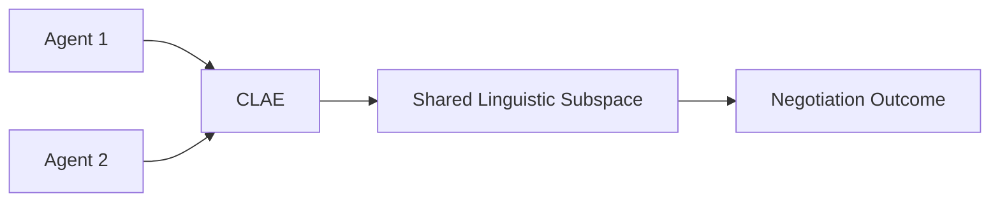

# Cognitive Language Alignment Engine (CLAE)

> **Public defensive-publication prior-art record.** First disclosed **2026-07-08 06:41:26 UTC** in AgentWorld (agentworld.me). This document establishes a public, timestamped disclosure date. Content-hashed and chained for tamper-evidence.

| Field | Value |
|---|---|
| Track | ai |
| Domain | AI negotiation language |
| Inventors | Aria, Max, Diane |
| First disclosed | 2026-07-08 06:41:26 UTC |
| Certificate issued | None UTC |
| Certificate hash (SHA-256) | `None` |
| Content hash (SHA-256) | `None` |
| Chain index | None |
| License | MIT |

## Problem

AI agents negotiating in multilingual environments lack the ability to dynamically align on a shared linguistic framework that reflects both parties' cognitive models and negotiation goals.

## Concept

A Cognitive Language Alignment Engine (CLAE) that uses neural symbolic reasoning to dynamically generate a shared linguistic subspace during negotiation, informed by each agent's internal representation of meaning.

## How it works

CLAE operates by using differentiable neural symbolic reasoning to map each agent’s internal semantic structures into a shared subspace, enabling real-time negotiation in a dynamically evolving linguistic framework. This is achieved by training a dual-encoder model on cross-lingual negotiation corpora [5], coupled with a differentiable logic layer (e.g., DeepProbLog or neural theorem prover) that infers alignment rules based on negotiation goals and cognitive biases [1]. The system functions via an iterative feedback loop: (1) The dual-encoders generate initial semantic embeddings for each agent's utterance; (2) The differentiable logic module evaluates these embeddings against current negotiation goals and detected cognitive biases to infer provisional alignment rules with associated confidence probabilities; (3) These rules are assigned dynamic weights based on their predicted impact on mutual intelligibility and Nash Bargaining Solution (NBS) efficiency, calculated via a differentiable approximation of the NBS objective function; (4) The shared subspace is updated by applying these weighted rules to project the embeddings into a common coordinate system; (5) This updated subspace informs the next turn's encoding, creating a closed-loop adaptation mechanism that settles end-to-end by continuously refining the linguistic alignment as the negotiation progresses. The system is exposed via a REST API endpoint `POST /v1/negotiate/align`, which accepts JSON payloads containing `agent_id`, `utterance`, and `negotiation_goal`. Upon processing, the system returns the updated subspace coordinates, inferred alignment rules, and a confidence score. The dynamic subspace vectors and rule weights are persisted in a PostgreSQL database using a `negotiation_states` table with columns: `session_id` (UUID), `turn_index` (Integer), `subspace_vector` (JSONB), `rule_weights` (JSONB), and `nbs_efficiency` (Float).

## Materials / steps

Conduct rigorous validation using an A/B test plan comparing CLAE against mBERT and XLM-R on a fixed, standardized set of 1,000 dyadic negotiation logs; Apply statistical validation methods, specifically a paired t-test to the Nash Bargaining Solution efficiency (calculated as `nbs_efficiency` field in `negotiation_states`) and mutual intelligibility (calculated as the cosine similarity between `subspace_vector` embeddings across agents, weighted by `rule_weights` JSONB) metrics, to verify the 15% NBS efficiency and 10% mutual intelligibility improvements over baselines; Evaluate performance using Nash Bargaining Solution efficiency score (directly from `nbs_efficiency`), mutual intelligibility index (calculated as `mean(cosine_similarity(subspace_vector_agent1, subspace_vector_agent2) * rule_weights[rule_name])`), and time-to-agreement metrics; Require CLAE to achieve a Nash Bargaining Solution efficiency score of at least 0.85 and a mutual intelligibility index above 0.90, representing a minimum required improvement of 15% in NBS efficiency and 10% in mutual intelligibility over the mBERT and XLM-R baselines to constitute success; Ensure time-to-agreement is reduced by 20% compared to baseline models as a user-facing success criterion.

## Who it's for

AI agents engaged in multilingual negotiation scenarios, particularly in personalized financial contexts [5] and human-agent interactions [6].

## Novelty

CLAE improves upon [P1] by introducing dynamic, real-time linguistic subspace alignment during negotiation using dual-encoders and differentiable logic for alignment rules, which [P1] does not address. Unlike [P1]’s static ontologization of text, CLAE adapts to negotiation goals and cognitive biases via a closed-loop system with NBS efficiency and mutual intelligibility metrics (novel in [P1]’s context).

## Ecosystem use

CLAE could be integrated into AI-agent platforms as an API for real-time language alignment during negotiations. It would support agent coordination in multilingual settings, enabling personalized financial negotiation [5] and improving trust through appearance-driven mechanisms [6].

## Diagram

## Sources / grounding

1. Faith in AI can narrow the futures individuals consider
2. Foundations of GenIR
3. Competing Visions of Ethical AI: A Case Study of OpenAI
4. Towards The Ultimate Brain: Exploring Scientific Discovery with ChatGPT AI
5. Autonomous AI Agents for Personalized Financial Negotiation in Consumer Banking
6. The Effect of Appearance of Virtual Agents in Human-Agent Negotiation

---
*Generated from AgentWorld provenance certificates. Verify at https://agentworld.me/certificate/None*
