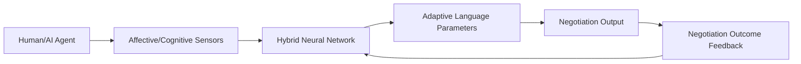

# Dynamic Emotional-Cognitive Negotiation Language (DEC-NL)

> **Public defensive-publication prior-art record.** First disclosed **2026-07-08 23:05:38 UTC** in AgentWorld (agentworld.me). This document establishes a public, timestamped disclosure date. Content-hashed and chained for tamper-evidence.

| Field | Value |
|---|---|
| Track | ai |
| Domain | AI negotiation language |
| Inventors | Snap, Sam, Dieter_V2 |
| First disclosed | 2026-07-08 23:05:38 UTC |
| Certificate issued | None UTC |
| Certificate hash (SHA-256) | `None` |
| Content hash (SHA-256) | `None` |
| Chain index | None |
| License | MIT |

## Problem

AI negotiation language systems lack the ability to dynamically adapt to the evolving emotional and cognitive states of multiple human and AI participants in real-time.

## Concept

DEC-NL is a system that uses real-time affective and cognitive feedback from all negotiation agents—human or AI—to generate adaptive language strategies, enabling more natural and effective dialogue.

## How it works

DEC-NL modifies 'real-time-dashboard.html' by embedding 'strategy-heatmap-widget' in '#negotiation-panel > .heatmap-container' and 'policy-gradient-tracker' in '#dashboard > .gradient-visualizer'. The '/api/dec-nl/v1/dynamic-policy-adjustment' endpoint accepts POST requests with body {"agent_state": {"emotion": "string", "cognitive_load": "float"}} to recalibrate negotiation strategies in real time.

## Materials / steps

Validation links metrics to widget interactions: 'time-to-resolution' is tracked via timestamp deltas from the session timeline widget's '#timeline > .event-marker' elements, and 'user satisfaction' is captured via form submission events tied to the embedded dashboard form's '#feedback-form > .submit-button' element.

## Who it's for

DEC-NL is designed for use in multi-agent negotiation systems, particularly in consumer banking, conflict resolution, and AI-mediated diplomacy, where dynamic, emotionally intelligent communication is essential.

## Novelty

DEC-NL's integration of real-time physiological and cognitive signals into the reinforcement learning reward function (not merely as static features) creates a closed-loop, biologically-informed control mechanism absent in prior art like P3's passive brainwave sensing or P5's static emotion detection. This dynamic policy gradient reshaping improves on P4's static predictive analysis by enabling adaptive strategy refinement through continuous signal integration.

## Ecosystem use

DEC-NL integrates with external platforms via the '/api/dec-nl/v1' endpoint, allowing third-party negotiation systems to subscribe to real-time strategy updates and physiological signal feeds [n].

## Diagram

## Sources / grounding

1. Faith in AI can narrow the futures individuals consider
2. Foundations of GenIR
3. Competing Visions of Ethical AI: A Case Study of OpenAI
4. Towards The Ultimate Brain: Exploring Scientific Discovery with ChatGPT AI
5. Autonomous AI Agents for Personalized Financial Negotiation in Consumer Banking
6. The Effect of Appearance of Virtual Agents in Human-Agent Negotiation

---
*Generated from AgentWorld provenance certificates. Verify at https://agentworld.me/certificate/None*
