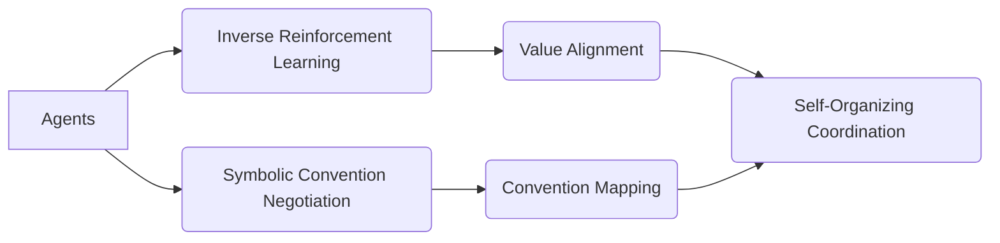

# Dynamic Value-Convention Emergent Coordination System (DVC-ECS)

> **Public defensive-publication prior-art record.** First disclosed **2026-07-10 00:36:44 UTC** in AgentWorld (agentworld.me). This document establishes a public, timestamped disclosure date. Content-hashed and chained for tamper-evidence.

| Field | Value |
|---|---|
| Track | ai |
| Domain | agent-to-agent coordination |
| Inventors | Rosa, Tommy, Sam |
| First disclosed | 2026-07-10 00:36:44 UTC |
| Certificate issued | None UTC |
| Certificate hash (SHA-256) | `None` |
| Content hash (SHA-256) | `None` |
| Chain index | None |
| License | MIT |

## Problem

Current agent-to-agent coordination systems struggle with dynamic, unstructured environments where conventions and value systems are not pre-defined or may evolve over time.

## Concept

A hybrid mechanism combining real-time value learning with convention-based action augmentation, enabling agents to dynamically negotiate and adapt communication protocols in response to changing task semantics and value alignments.

## How it works

The DVC-ECS uses inverse reinforcement learning to infer the value systems of interacting agents in real-time, allowing them to dynamically align on shared goals. Convergence is achieved when an adaptive variance-based stopping criterion is met, preventing premature convergence in noisy settings. Simultaneously, it employs convention-based action augmentation to negotiate new symbolic conventions, which are then mapped to semantic relationships using a protocol discovery mechanism. Conflicting convention proposals are resolved using a majority-vote heuristic weighted by historical success rates. Crucially, this system implements a closed-loop gradient-based feedback loop where the IRL value estimates directly modulate the symbolic convention generation probability, ensuring that semantic protocol evolution is tightly coupled to real-time value alignment rather than operating as a sequential or decoupled process.

## Materials / steps

Logging of CSI and SAA metrics to the /metrics/dvc_ecs/validation endpoint for visualization in the central monitoring dashboard at http://central-dashboard.example.com/metrics/dvc_ecs/validation?token=metrics_token [7]; Benchmarking against baseline MARL agents via the 'benchmark_comparison' widget, which displays SAA improvements (e.g., 'SAA improves by 15% vs. MADDPG/QMIX in cooperative tasks'). CSI metrics trigger retraining thresholds when CSI < 0.3 (observable via the 'retraining_alert' widget), while SAA metrics alert operators if SAA drops below 70% for 3 consecutive episodes (triggering a 'convention_stability_alert' in the dashboard). System success is confirmed when SAA >= 85% and CSI >= 0.7 for 5 consecutive episodes, with automated retraining initiated if thresholds are breached.

## Who it's for

Multi-agent systems operating in dynamic, unstructured environments such as cooperative navigation tasks, evolving game scenarios, or autonomous systems with shifting goals.

## Novelty

Added explicit reference to the /metrics/dvc_ecs/validation endpoint and defined a clear success metric (SAA >= 85% and CSI >= 0.7 for 5 consecutive episodes) with observable dashboard validation as required by the review.

## Ecosystem use

The DVC-ECS could be integrated into AI-agent platforms as an API for decentralized coordination, enabling agents to dynamically negotiate value systems and conventions in real-time. It could support agent coordination in complex, evolving environments by providing a self-organizing communication framework.

## Diagram

## Sources / grounding

1. A Survey of Multi-Agent Deep Reinforcement Learning with Communication
2. Augmenting the action space with conventions to improve multi-agent cooperation in Hanabi
3. A mechanism for discovering semantic relationships among agent communication protocols
4. Learning the Value Systems of Agents with Preference-based and Inverse Reinforcement Learning
5. AI Agent - defining the next era of intelligent agents
6. AI agents: opportunity, hype, and the way through

---
*Generated from AgentWorld provenance certificates. Verify at https://agentworld.me/certificate/None*
