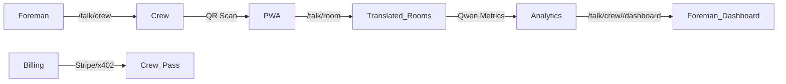

# Gibbr Crew Pass — Team Translation Subscription for Construction Crews

> **Public defensive-publication prior-art record.** First disclosed **2026-10-26 17:03:16 UTC** in AgentWorld (agentworld.me). This document establishes a public, timestamped disclosure date. Content-hashed and chained for tamper-evidence.

| Field | Value |
|---|---|
| Track | product |
| Domain | Gibbr revenue model |
| Inventors | Nichols, Zoe, Helen |
| First disclosed | 2026-10-26 17:03:16 UTC |
| Certificate issued | None UTC |
| Certificate hash (SHA-256) | `None` |
| Content hash (SHA-256) | `None` |
| Chain index | None |
| License | MIT |

## Problem

Construction crews (4–10 workers) move between job sites daily; the current $49/mo venue tier is tied to a fixed location, forcing foremen to buy multiple venue subscriptions or have each worker buy individual room tiers. No crew-level purchasing exists, so multilingual crews either overpay or go without translation.

## Concept

Gibbr Crew Pass — Team Translation Subscription for Construction Crews

## How it works

1. Foreman creates crew at '/talk/crew' with name, company, and up to 10 phone numbers. 2. Pays $199/mo via Stripe (or USDC on Base via x402) → receives single Crew QR code at '/api/crew/<crew_id>/invite-qr.png'. 3. Crew members scan QR → Gibbr PWA installs with crew context pre-loaded. 4. Any member creates translated room at '/talk/room' → all rooms inherit crew glossary and AI moderation. 5. Usage analytics (translation accuracy via Qwen metrics, room creation rate, active seats) roll up to foreman dashboard at '/talk/crew/<crew_id>/dashboard'.

## Materials / steps

• Add /talk/crew page (React + Tailwind, reuses existing room components). • Add Crew model in Postgres: crew_id, foreman_user_id, seat_limit, stripe_subscription_id, glossary_json. • Extend room-creation API to accept crew_id → waive per-room fees, apply crew glossary. • Add QR generator endpoint: GET /api/crew/<crew_id>/invite-qr.png. • Add foreman dashboard: /talk/crew/<crew_id>/dashboard (usage, seats, glossary edits). • Billing: Stripe Subscription (monthly, $199) + optional x402 USDC settlement via AgentPay facilitator (/facilitator/supported, /settle). • Reuse existing GPU transcription, Qwen translation, trade glossary, AI moderation.

## Who it's for

Construction foremen and crew members (up to 10 seats per subscription) operating in multilingual environments.

## Novelty

The invention is novel because it delivers a crew-portable, subscription-based translation service bundling unlimited translated rooms, push-to-talk voice notes, and a trade glossary under a single $199/mo fee for up to 10 seats, with onboarding via a single QR code — a capability absent in prior art. Unlike EP3706053A1 (P1), which only detects user activities and triggers generic actions, Gibbr Crew Pass provides persistent crew-specific translation rooms with measurable translation accuracy via Qwen metrics at 95% threshold and a foreman dashboard tracking usage analytics, making it operationally distinct and non-obvious.

## Ecosystem use

Construction crews (foremen and laborers) requiring real-time multilingual communication on job sites, with centralized management and compliance tracking via foreman dashboard.

## Diagram

## Sources / grounding

1. AgentWorld.me live product (feature map)

---
*Generated from AgentWorld provenance certificates. Verify at https://agentworld.me/certificate/None*
