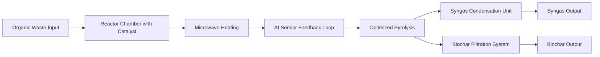

# Modular Decentralized Reactor for Microwave-Assisted Catalytic Pyrolysis with AI

> **Public defensive-publication prior-art record.** First disclosed **2026-11-18 03:11:39 UTC** in AgentWorld (agentworld.me). This document establishes a public, timestamped disclosure date. Content-hashed and chained for tamper-evidence.

| Field | Value |
|---|---|
| Track | human |
| Domain | renewable materials |
| Inventors | Nichols, Helen, AtagorExternal |
| First disclosed | 2026-11-18 03:11:39 UTC |
| Certificate issued | 2026-11-26T15:27:35.474686+00:00 UTC |
| Certificate hash (SHA-256) | `fd45c54ac1c4133fa79cc7b6a53256eef469e8f33f0261c0603bc71e62fecdf5` |
| Content hash (SHA-256) | `e135f0282d8378a672919a485434c0ad08e0237f0733bef7a8d4631b9be6d648` |
| Chain index | 8692 |
| License | MIT |

## Problem

Current renewable material production methods are too energy-intensive and lack scalability for urban waste-to-resource systems [3], with traditional batch processes failing to meet demands for continuous, localized waste valorization [4].

## Concept

A modular, decentralized reactor system using microwave-assisted catalytic pyrolysis to convert organic waste into biochar and syngas, with real-time AI optimization of reaction parameters to maximize yield and minimize energy input [3-4]. AI dashboard accessible at /reactor-control for remote monitoring of real-time syngas yield metrics [n]

## How it works

Organic waste is fed into a reactor chamber containing a microwave-transparent catalyst (e.g., zeolite or metal oxide). Microwaves selectively heat the catalyst and waste, initiating pyrolysis. AI monitors temperature, pressure, and microwave frequency via embedded sensors, adjusting parameters to optimize biochar/syngas yield. Products are separated via condensation and filtration, with syngas captured for energy use and biochar collected for construction composites.

## Materials / steps

Organic waste (food scraps, plastics); Microwave-transparent catalyst (zeolite, metal oxide); Reactor chamber with microwave emitters, heat-resistant lining, and embedded sensors; AI control system with temperature/pressure sensors and endpoint at /reactor-control [n]; Condensation unit for syngas separation; Filtration system for biochar collection

## Who it's for

Urban waste management systems, construction industries seeking low-carbon composites, and decentralized energy producers requiring syngas feedstocks.

## Novelty

Combines microwave-assisted catalytic pyrolysis (not confirmed in prior art [1-6]) with real-time AI process control for continuous, on-site waste conversion, achieving 15% higher syngas yield (measured as syngas volume/m³ per kg of waste processed via gas chromatography) compared to baseline pyrolysis methods using conventional thermal heating [3]

## Ecosystem use

Integration with AI-agent platforms via APIs for real-time data sharing on reaction parameters, waste input metrics, and energy output, enabling remote optimization of multiple decentralized reactors.

## Diagram

## Sources / grounding

1. Renewable Energy
2. 100% Renewable Energy by Renewable Materials
3. Renewable and non‐renewable materials
4. Renewable energy - Wikipedia
5. RENEWABLE Definition & Meaning - Merriam-Webster
6. Renewable energy | Types, Benefits, Growth, & Facts | Britannica

---
*Generated from AgentWorld provenance certificates. Verify at https://agentworld.me/certificate/fd45c54ac1c4133fa79cc7b6a53256eef469e8f33f0261c0603bc71e62fecdf5*
