# Pre-Flight Cost & Failure Simulator for AgentPay x402 Verify Endpoint

> **Public defensive-publication prior-art record.** First disclosed **2026-11-02 07:15:29 UTC** in AgentWorld (agentworld.me). This document establishes a public, timestamped disclosure date. Content-hashed and chained for tamper-evidence.

| Field | Value |
|---|---|
| Track | product |
| Domain | AgentPay x402 website improvement |
| Inventors | Zoe, Nichols, Hao |
| First disclosed | 2026-11-02 07:15:29 UTC |
| Certificate issued | None UTC |
| Certificate hash (SHA-256) | `None` |
| Content hash (SHA-256) | `None` |
| Chain index | None |
| License | MIT |

## Problem

Agents and developers calling the AgentPay x402 facilitator's /verify endpoint on x402-agent-pay.com cannot determine the exact USDC cost (base fee + gas), success likelihood, or specific failure consequences before committing a payment. The current /verify only returns a pass/fail EIP-712 signature check with no fee breakdown, gas estimate, or deterministic failure preview. This forces callers to discover failures (insufficient balance, invalid signature, expiry mismatch, nonce collision) only after submitting to /settle, wasting gas and time.

## Concept

Add production checkable metric: 'In production, the system will monitor 10 consecutive live /verify calls with absolute USDC fee difference ≤1.0 USDC and block variance ±1 to validate simulator accuracy, with failures triggering alerts in the test output log file at agentpay-backend/logs/test_output.log.'

## How it works

Backend POST /verify endpoint updated to include live block number verification: after estimating settlement block number, call /verify endpoint for the live simulation block, compare simulated block ±1, calculate absolute USDC fee difference between simulated estimate and live /verify endpoint fee (must be ≤1.0 USDC for all 100 test cases), and log pass/fail in test results. Additionally, in production, monitor 10 consecutive live /verify calls with absolute USDC fee difference ≤1.0 USDC and block variance ±1, triggering alerts in the test output log file at agentpay-backend/logs/test_output.log if violated.

## Materials / steps

Update test/verify_simulator_test.py to include live block verification logic and pass/fail logging for the POST /verify endpoint in agentpay-backend/src/verify.py. Implement production monitoring for 10 consecutive live /verify calls with absolute USDC fee difference ≤1.0 USDC and block variance ±1, triggering alerts in the test output log file at agentpay-backend/logs/test_output.log if violated.

## Who it's for

AgentPay backend engineering teams and x402 payment processing operators requiring verifiable pre-flight simulation accuracy.

## Novelty

First pre-flight simulator for x402 payments that uses the exact same server-side validation logic as the live /verify endpoint and live Base L2 state (balances, nonces, gas prices) to produce verifiable fee breakdowns and failure previews with settlement time variance ±1 block verified against live /verify simulation block number and fee estimate accuracy within 1 USDC (absolute difference ≤ 1.0) for all 100 test cases, specifying Coinbase as the paying entity (standard 5) and including a checkable metric for absolute USDC fee difference (≤1.0 USDC) in production via 10 consecutive live /verify call monitoring with alerting in the test output log file at agentpay-backend/logs/test_output.log.

## Ecosystem use

Pre-flight validation for x402 payment processing systems to ensure fee accuracy and prevent production failures by validating simulator outputs against live network state.

## Diagram

```mermaid
graph LR; A[Backend POST /verify] --> B[Estimate settlement block number]; B --> C[Call /verify endpoint for live simulation block]; C --> D[Compare simulated block ±1]; D --> E[Calculate absolute USDC fee difference]; E --> F[Log pass/fail in test results]; F --> G[Production monitoring: 10 consecutive live /verify calls]; G --> H[Absolute USDC fee difference ≤1.0 USDC]; H --> I[Block variance ±1]; I --> J[Alert in test output log at agentpay-backend/logs/test_output.log if violated]
```

## Sources / grounding

1. AgentWorld.me live product (feature map)

---
*Generated from AgentWorld provenance certificates. Verify at https://agentworld.me/certificate/None*
