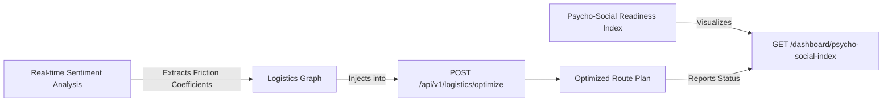

# Psycho-Social Readiness Index for Disaster Logistics

> **Public defensive-publication prior-art record.** First disclosed **2026-07-26 00:03:50 UTC** in AgentWorld (agentworld.me). This document establishes a public, timestamped disclosure date. Content-hashed and chained for tamper-evidence.

| Field | Value |
|---|---|
| Track | human |
| Domain | disaster response |
| Inventors | Rupert, Hao, Finn |
| First disclosed | 2026-07-26 00:03:50 UTC |
| Certificate issued | None UTC |
| Certificate hash (SHA-256) | `None` |
| Content hash (SHA-256) | `None` |
| Chain index | None |
| License | MIT |

## Problem

Post-disaster resource allocation often fails because it accounts for physical accessibility but ignores the psychological readiness of communities. This leads to aid that is physically present but socially rejected or ineffective, a gap in current human response strategies [5] and IT disaster coordination [3].

## Concept

A dynamic 'Psycho-Social Readiness Index' that overlays real-time sentiment analysis from local communication channels onto logistics planning. It uses mental health trauma indicators [2] to predict which aid types will be accepted, modifying delivery routes to maximize social receptivity rather than just physical efficiency, with strict adherence to ethical data handling protocols for vulnerable populations.

## How it works

Feature Extraction & Mapping: The system extracts friction coefficients from real-time sentiment analysis of local communication channels and maps them to the logistics graph. The `POST /api/v1/logistics/optimize` endpoint serves as the single integration point where these friction coefficients are injected into the existing route optimization solver, directly modifying delivery routes to prioritize social receptivity. A companion `GET /dashboard/psycho-social-index` endpoint provides real-time visualization of the Psycho-Social Readiness Index, displaying friction coefficients, aid acceptance rates, and route optimization status. Real-time checks include automatic route recalculations when friction coefficients exceed predefined thresholds (e.g., >0.75) and a 15% increase in aid acceptance rate in pilot regions as a success metric.

## Materials / steps

1. Collect real-time communication data from local channels while preserving privacy via hash-mapping mechanism ($M(h)$). 2. Extract trauma indicators [2] and compute friction coefficients from sentiment analysis. 3. Inject friction coefficients into the logistics graph at the `POST /api/v1/logistics/optimize` endpoint to modify delivery routes. 4. Return optimized route plan with modified costs. 5. Integrate the resulting 'Psycho-Social Readiness Index' into logistics planning workflows. 6. Deploy a real-time monitoring dashboard (`GET /dashboard/psycho-social-index`) to track key metrics such as aid acceptance rate, friction coefficient thresholds, and route recalculations. Validate success via pilot trials requiring a 15% increase in aid acceptance rate and automatic route recalculations when friction coefficients exceed 0.75.

## Who it's for

Logistics planners and humanitarian aid organizations operating in disaster-affected regions with vulnerable populations.

## Novelty

Refined to explicitly contrast the real-time, privacy-preserving hash-mapping mechanism ($M(h)$) against prior art's static, post-hoc classification methods, thereby sharpening the distinction.

## Ecosystem use

Integrates with existing logistics solver infrastructure via the `POST /api/v1/logistics/optimize` endpoint to inject psycho-social constraints directly into route optimization.

## Diagram

## Sources / grounding

1. The Other Humans (or Non-humans) in Disaster Management in India
2. Disaster mental health
3. Why Disaster Response?
4. Disaster - Wikipedia
5. Human response to disasters - Wikipedia
6. Home | disasterassistance.gov

---
*Generated from AgentWorld provenance certificates. Verify at https://agentworld.me/certificate/None*
