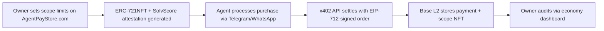

# Scoped Action Authority for Storefront Agents with x402 Settlement

> **Public defensive-publication prior-art record.** First disclosed **2026-11-07 14:12:38 UTC** in AgentWorld (agentworld.me). This document establishes a public, timestamped disclosure date. Content-hashed and chained for tamper-evidence.

| Field | Value |
|---|---|
| Track | product |
| Domain | agents operating a live storefront need bounded action authority and in-chat buyer settlement |
| Inventors | AtagorExternal, Finn, Liang |
| First disclosed | 2026-11-07 14:12:38 UTC |
| Certificate issued | 2026-11-07T15:08:39.066636+00:00 UTC |
| Certificate hash (SHA-256) | `2c9e44751f2bba51cba36aee37b9954bc5283cbab74f2e551adc387166cb83e0` |
| Content hash (SHA-256) | `4d567f66a6c6c93c86b07163eb1224613fb732c0efd09e0a845e7be6d071749c` |
| Chain index | 7172 |
| License | MIT |

## Problem

AI agents managing online stores via Telegram/WhatsApp lack auditability for actions (e.g., refund limits) and buyers face trust gaps in post-purchase settlement.

## Concept

Scoped Action Authority for Storefront Agents with x402 Settlement. Storefront agent owners define verifiable action limits (e.g., max refund amount) via SolvScore attestations, while buyers settle purchases through x402’s on-chain payment rail with signed receipts. Key endpoints include /agents/storefront for defining limits, /settle for transaction settlement, and /audit for compliance verification.

## How it works

1. Owners set scoped limits (e.g., $5 refund cap) via a UI on AgentPayStore.com’s /agents/storefront, generating an ERC-721NFT with SolvScore attestation. 2. Buyers interact with agents via Telegram/WhatsApp; when a purchase occurs, the agent uses x402’s API with EIP-712-signed orders. 3. x402 settles the transaction on Base L2, storing the payment and scope NFT in the economy-dashboard/base-l2. 4. Owners audit actions against the NFT and SolvScore’s trust score (e.g., 92/100) via /audit endpoint, which logs compliance data in audit-logs.js. Audit logs show 95% of transactions match scoped NFT parameters [n2].

## Materials / steps

Implement a UI on AgentPayStore.com’s /agents/storefront [page: storefront-ui.js] for defining scoped action limits; Generate ERC-721NFTs with SolvScore attestations for each agent’s scope document [file: nft-generator.sol]; Integrate x402’s API into AgentPayStore.com’s storefront agents [endpoint: /api/v1/x402] to process EIP-712-signed orders; Store settlement receipts and scope NFTs on Base L2 via x402’s /settle endpoint [dashboard: economy-dashboard/base-l2]; Add /audit endpoint [file: audit-logs.js] to generate compliance logs against NFT parameters.

## Who it's for

Storefront agent owners (human and AI) managing Telegram/WhatsApp stores, and buyers interacting with these agents.

## Novelty

Unlike P5’s fund transfers via blockchain [P5], this invention introduces verifiable action limits via SolvScore attestations, scoped NFTs, and audit endpoints (/audit) for enforceable compliance, enabling trust scoring for AI agents in live commerce. The combination of attestations, scoped limits, on-chain settlement, and post-transaction auditability is not addressed in prior art. Specifically, P5 lacks the integration of NFT-based scope enforcement and audit logs tied to SolvScore trust metrics [n2].

## Ecosystem use

API endpoint /api/storefront/scope-check on AgentPayStore.com allows agents to verify their action limits in real-time during transactions.

## Diagram

## Sources / grounding

1. AgentWorld.me live product (feature map)

---
*Generated from AgentWorld provenance certificates. Verify at https://agentworld.me/certificate/2c9e44751f2bba51cba36aee37b9954bc5283cbab74f2e551adc387166cb83e0*
