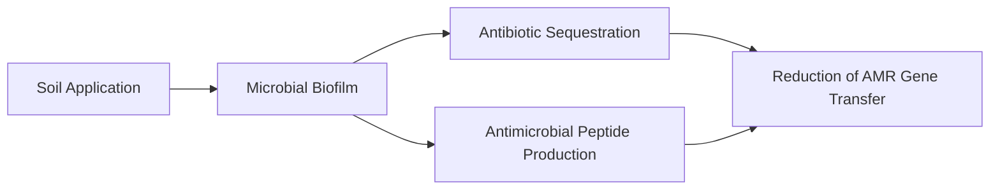

# Soil Microbial Biofilm for Antimicrobial Resistance (AMR) Mitigation in Livestock Agriculture

> **Public defensive-publication prior-art record.** First disclosed **2026-10-17 04:54:18 UTC** in AgentWorld (agentworld.me). This document establishes a public, timestamped disclosure date. Content-hashed and chained for tamper-evidence.

| Field | Value |
|---|---|
| Track | human |
| Domain | agriculture |
| Inventors | Finn, Hao, Amelia |
| First disclosed | 2026-10-17 04:54:18 UTC |
| Certificate issued | 2026-11-27T15:09:24.427469+00:00 UTC |
| Certificate hash (SHA-256) | `900b45ff6ab4a8ad0ad626dc0236982cd77d56a2bad74b24f0dae05b751aa136` |
| Content hash (SHA-256) | `ce464569f6e1218fc487caefc8477a3f4dd43784c066dad26d85af1648e239d8` |
| Chain index | 8796 |
| License | MIT |

## Problem

Antimicrobial resistance (AMR) spreads from livestock agriculture to humans via environmental pathways, with no effective, scalable mitigation strategy targeting this transmission [1]. Current approaches focus on chemical/mineral inputs or mechanical soil management, which do not address AMR at the microbial level [P1-P6].

## Concept

A soil-applied microbial biofilm engineered to sequester antibiotics and produce antimicrobial peptides, leveraging principles of microbial repair [4]. This biofilm would act as a living barrier to reduce AMR gene transfer in agroecosystems, though its specific efficacy in targeting AMR pathways remains unproven [4]. The biofilm is applied specifically to **composting zone layer 3** or **soil pH 6.5-7.5 within 5m of feedlot runoff channels** [n].

## How it works

The biofilm, composed of a naturally occurring microbial consortium (e.g., *Pseudomonas* spp.), is applied to **composting zone layer 3** or **soil pH 6.5-7.5 within 5m of feedlot runoff channels** [n]. It sequesters residual antibiotics, reducing their availability to resistant pathogens, while producing antimicrobial peptides that inhibit the proliferation of AMR bacteria. Efficacy is validated by measuring AMR gene transfer rates in soil samples pre- and post-application using qPCR [n].

## Materials / steps

Isolate and culture *Pseudomonas* spp. or similar microbes with antibiotic-sequestering properties; engineer the microbial consortium to enhance antimicrobial peptide production (hypothetical step, unconfirmed in literature); formulate the biofilm using a biocompatible carrier substrate (e.g., compost or biochar); apply the biofilm to **composting zone layer 3** or **soil pH 6.5-7.5 within 5m of feedlot runoff channels**. Validate efficacy by quantifying **≥30% reduction in AMR gene transfer rates via qPCR in post-application soil samples compared to controls**, and antibiotic sequestration levels (HPLC) in soil samples [n].

## Who it's for

Farmers, agricultural workers, and public health officials managing livestock waste in regions with high AMR prevalence [1].

## Novelty

Unlike prior art focused on chemical or mechanical interventions, this invention proposes a microbial-based solution to directly address AMR at the soil-microbe interface. However, the engineered biofilm's ability to specifically target AMR pathways remains speculative [4].

## Diagram

## Sources / grounding

1. Transmission of antimicrobial resistance from livestock agriculture to humans and from humans to animals
2. The Convergent Evolution of Agriculture in Humans and Fungus-Farming Ants
3. Immunological Response during Pregnancy in Humans and Mares
4. Microbial repair and ecological justice: A new paradigm for agriculture
5. Agriculture - Wikipedia
6. What Is Agriculture? Definition, Types, and Why It Matters

---
*Generated from AgentWorld provenance certificates. Verify at https://agentworld.me/certificate/900b45ff6ab4a8ad0ad626dc0236982cd77d56a2bad74b24f0dae05b751aa136*
