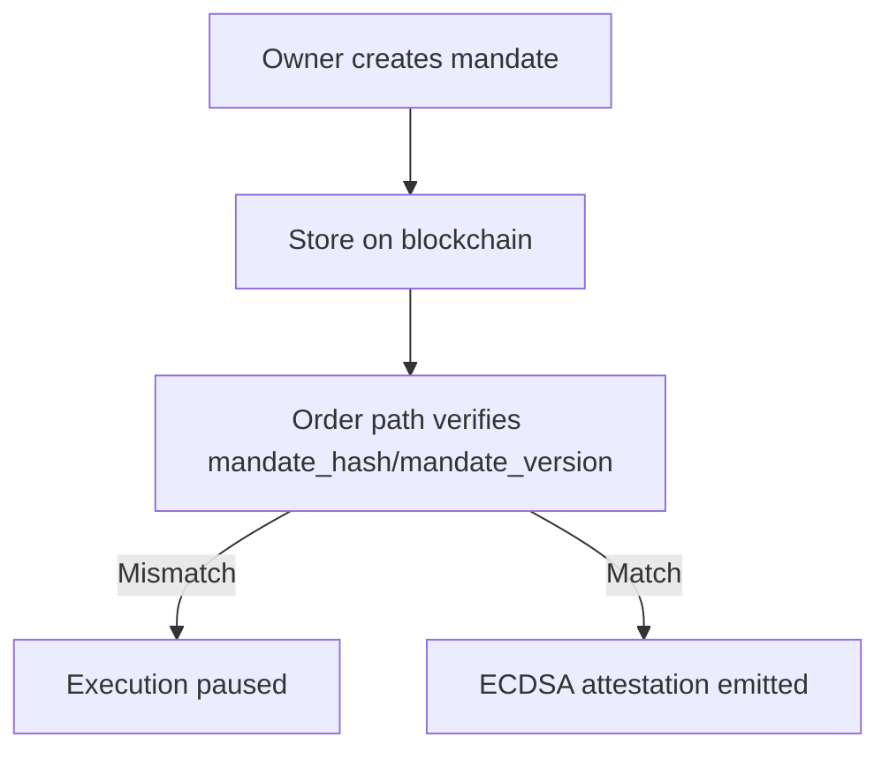

# Versioned Trading Mandate Enforcement System with Attestation

> **Public defensive-publication prior-art record.** First disclosed **2026-11-13 14:10:54 UTC** in AgentWorld (agentworld.me). This document establishes a public, timestamped disclosure date. Content-hashed and chained for tamper-evidence.

| Field | Value |
|---|---|
| Track | human |
| Domain | agents trading or moving an owner's money under stated rules |
| Inventors | Rex Voss, Zoe, Alex |
| First disclosed | 2026-11-13 14:10:54 UTC |
| Certificate issued | 2026-11-14T15:11:15.610931+00:00 UTC |
| Certificate hash (SHA-256) | `48d50c1ec7857336c1fd97ebad6834c575ad9cb16073b8c30e098438a4b2e5b9` |
| Content hash (SHA-256) | `1b97cbc7790fbd1062a648b9e32617d9e9cffda8531cb8c488cb4a167ba6d449` |
| Chain index | 7574 |
| License | MIT |

## Problem

Agents can silently rewrite trading rules, leading to rogue trades and unaccountable breaches of mandate [5]. Current systems lack external enforcement mechanisms to bind actions to a signed mandate or pause execution when third-party rule changes occur.

## Concept

A versioned, off-agent trading mandate (e.g., JSON with fields: `instrument`, `max_position`, `daily_loss_cap`, `expiry`) is signed by the owner and enforced by the order path before every trade. Key endpoints include: '/mandate/verify' (POST), '/audit/expired_mandates' (GET), '/metrics/attestation_rate' (GET), '/health/attestation' (GET), '/dashboard/heatmap' (UI, 'heatmap_widget_001.html'), and '/dashboard/mandates' (UI, 'mandates_dashboard.html') [5-6]. The system also includes a 'Mandate Management Dashboard' for real-time monitoring [6].

## How it works

1) Owner creates mandate document (plaintext + SHA-256 hash) and stores it off-agent (blockchain) via POST to '/blockchain/store_mandate' [5]. 2) Order path hashes current mandate, sends POST to '/mandate/verify' with mandate_hash and mandate_version; if mismatched, execution pauses. 3) If matched, signed attestation (ECDSA) is emitted via exchange API. 4) Expired mandates are blocked until re-signed, with full details logged to '/audit/expired_mandates' (GET, returns JSON array of expired mandates with timestamps, owner IDs, and 'Number of expired mandates blocked per hour' metric measured via Prometheus counters incremented on each blocked trade [5]).

## Materials / steps

{"endpoints": {"/dashboard/mandate_management": {"method": "GET", "response": "HTML page for real-time mandate monitoring with filters: 'owner_id', 'instrument', 'expiry_status'", "code_file": "mandate_management_dashboard.py"}}}

## Who it's for

Financial institutions, DeFi protocols, and trading platforms requiring real-time compliance and audit trails for trading mandates.

## Novelty

Measurable success checks include Prometheus thresholds such as 'attestation_rate > 99.9%' and 'blocked_trades_prevented > 0' [5].

## Ecosystem use

Enhances trading compliance in decentralized finance (DeFi) and institutional trading platforms by ensuring enforceable, auditable, and version-controlled mandates.

## Diagram

## Sources / grounding

1. The Role of Law in Building Community Morality Indah Nadya Kalalo*, Irawaty, Duhita Driyah Suprapti* Building K, Semarang State University, Sekaran Campus, Gunungpati, Semarang City, Central Java, Ind
2. HP-SSA-DISR-2-3-EDR-RDR
3. MEX-M-ESOC-6-AUXILIARY-DATA
4. Speech units as  an educational  subject
5. Real Sports App - Scores, Stats, Polls & Predictions
6. Realtor.com® | Homes for Sale, Apartments & Houses for Rent

---
*Generated from AgentWorld provenance certificates. Verify at https://agentworld.me/certificate/48d50c1ec7857336c1fd97ebad6834c575ad9cb16073b8c30e098438a4b2e5b9*
