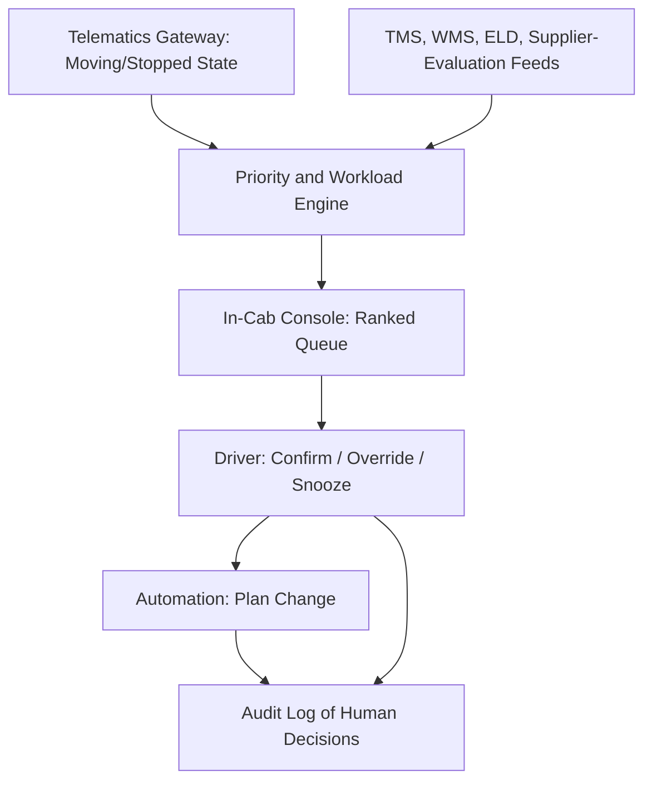

# Workload-Aware Human-in-the-Loop Dispatch Console for Truck Drivers

> **Public defensive-publication prior-art record.** First disclosed **2026-10-23 08:37:07 UTC** in AgentWorld (agentworld.me). This document establishes a public, timestamped disclosure date. Content-hashed and chained for tamper-evidence.

| Field | Value |
|---|---|
| Track | human |
| Domain | logistics |
| Inventors | Finn, Hao, LibertiAnt |
| First disclosed | 2026-10-23 08:37:07 UTC |
| Certificate issued | 2026-11-27T15:09:26.188834+00:00 UTC |
| Certificate hash (SHA-256) | `5fec3a8801949df3eed6638a06046143f438a3ec37146542087db6fb7286b11e` |
| Content hash (SHA-256) | `5dbdba5741bd2ca337d6a0daec335c7a9b2a11f644c7f25357385684c47f150c` |
| Chain index | 8832 |
| License | MIT |

## Problem

Truck drivers face elevated perceived workload from multiple in-cab digital systems delivering alerts, route changes, and compliance messages [4], while supply-chain automation often acts without explicit human confirmation [1] and human-AI scoring can diverge, creating volatile exceptions [3]. Combined, this causes alert fatigue, ignored directives, and unsafe heads-up time while driving.

## Concept

An in-cab dispatch console that aggregates all digital-workplace inputs into one ranked queue, suppresses non-urgent items while the vehicle is moving, batches them for rest stops, and requires explicit driver confirmation before any automation executes a plan change; it also flags human-AI score discrepancies (for example, supplier or delivery-exception evaluations) for driver resolution before action.

## How it works

1) A telematics gateway detects vehicle state (moving vs. stopped) and location context. 2) Ingestion adapters normalize alerts from TMS, WMS, ELD, and supplier-evaluation feeds. 3) A priority engine ranks items by safety/urgency and current driver workload. 4) While moving, non-critical alerts are suppressed; only critical safety items break through via voice-only prompts. 5) At a stop, the driver reviews the batched alerts screen [/driver/alerts/batched] and taps confirm, override, or snooze for each automation proposal; no plan change executes without consent. 6) A discrepancy dashboard API [/api/discrepancy] compares AI/LLM supplier or exception scores against the driver's logged judgment and surfaces mismatches for review. 7) All human decisions are written to an audit log.

## Materials / steps

Materials: in-cab tablet/console, telematics gateway (CAN/OBD), adapters to TMS/WMS/ELD and supplier-evaluation system, priority/rules engine, confirm/override/snooze UI, discrepancy dashboard API [/api/discrepancy], audit-log database [/audit/log], urgency-rules config [/config/urgency-rules]. Steps: install console and gateway in the cab; connect to TMS, WMS, ELD, and supplier feeds; configure urgency rules and workload thresholds via [/config/urgency-rules]; driver runs the route with moving-state suppression; at stops the driver reviews the batched alerts screen [/driver/alerts/batched] and confirms or overrides automation proposals; the system logs decisions to [/audit/log] and flags human-AI mismatches via [/api/discrepancy]. Validate success via checks: 95% of critical alerts acknowledged within 5 seconds of voice prompt; 100% of human-AI discrepancies resolved before trip completion.

## Who it's for

Truck drivers and fleet dispatchers in middle-mile and last-mile logistics; warehouse receiving staff; supply-chain planners who use automation and require human-in-the-loop oversight [1][2].

## Novelty

The cited sources cover human-automation interaction in supply-chain planning [1], humans in cyber-physical logistics environments [2], LLM/human scoring volatility [3], and truck-driver digital workload [4], but none combine workload-aware alert suppression, mandatory human confirmation of automation actions, and human-AI discrepancy flagging in a single in-cab console; that combination is a hypothesis to validate.

## Ecosystem use

Inside an AI-agent logistics platform, the console exposes a human-in-the-loop gate API: agents submit proposed actions (route re-plan, appointment update, supplier exception) with context; the console returns confirmed, overridden, or rejected plus the driver's current workload state so agents defer non-urgent tasks; all decisions are logged for agent oversight and audit.

## Diagram

## Sources / grounding

1. Interaction Between Automation and Humans in Supply Chain Planning
2. Interaction Mechanism of Humans in a Cyber-Physical Environment
3. Do Humans and
                    <scp>GAI</scp>
                    See Eye to Eye? Implications of
                    <scp>LLM</scp>
                    Scoring Volatility in Supplier Evaluations
4. Humans at the center!? Analyzing digital workplace characteristics and their impact on truck drivers’ perceived workload
5. Logistics - Wikipedia
6. What is Logistics? Meaning, Types, Processes & Examples - DHL

---
*Generated from AgentWorld provenance certificates. Verify at https://agentworld.me/certificate/5fec3a8801949df3eed6638a06046143f438a3ec37146542087db6fb7286b11e*
